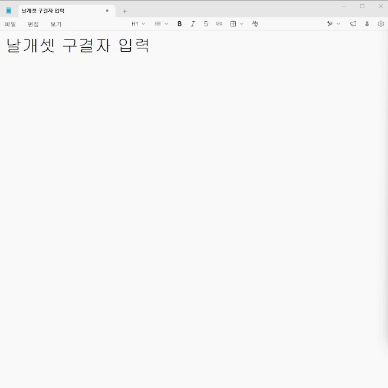

# 날개셋 구결자 입력

- `리`, `뎌` 등의 독음이나 `ㄱ`, `ㄷ` 등 초성을 입력 -> `shift+한자`를 눌러 구결자 변환 

## 설정 방법
## 구결자 파일 다운로드
- [날개셋 구결자 파일](https://github.com/go00ood/gugyeol/blob/main/nalgaeset%20gugyeol%20261121.txt)에 접속
- 파일 오른쪽 상단의 **Download raw file** 아이콘(<escape>↓</escape>)을 클릭
  - 다운로드 아이콘이 보이지 않으면 **Raw** 버튼 옆 메뉴(`...`)에서 다운로드 선택
- `nalgaeset gugyeol 261121.txt` 파일을 컴퓨터에 저장

### 1. 제어판 열기

- **날개셋 편집기 → 도구 → 날개셋 제어판** 실행
- 왼쪽 **입력기 계층**에서 사용할 입력 항목 선택 (예: `0* 두벌식 옛한글`)

### 2. 사용자 정의 후보 활성화

- 왼쪽 **입력기 계층 → 두벌식 옛한글 → 입력 일반** 선택

- **사용자 정의 후보 → 제2 내장형** 체크
- 활성화된 **설정(N)...** 클릭

### 3. 후보 파일 불러오기

- **내장형 후보 데이터** 창에서 **가져오기(R)...** 클릭
- 처음에 다운 받은 `nalgaeset gugyeol 261121.txt` 파일 선택
- **확인**을 눌러 후보 데이터 창 닫기

### 4. `Shift+한자` 단축글쇠 확인

- 제어판 왼쪽 **편집기 계층 → 단축글쇠** 선택
- 목록에 **`Shift+한자`** 항목이 있는지 확인
- 아래 값으로 설정되어 있는지 확인. 아니면 수정
  - **글쇠:** `Shift+한자`
  - **용도:** `2 낱개선택자 입력`
  - **계산식:** `C0|0x83`

### 5. 적용하고 입력하기

- 날개셋 제어판에서 **적용 → 확인** 순서로 저장
- 날개셋 편집기에서 해당 입력 항목 사용
- 원하는 글자(예: `뎌`)를 입력하고 **`Shift+한자`** 누르기
- 표시되는 구결자 후보 중 원하는 문자 선택
- 초성(예: `ㄱ`)을 키로 입력하면 그 초성에 묶어 둔 여러 독음의 구결자 후보를 한꺼번에 확인할 수 있음

